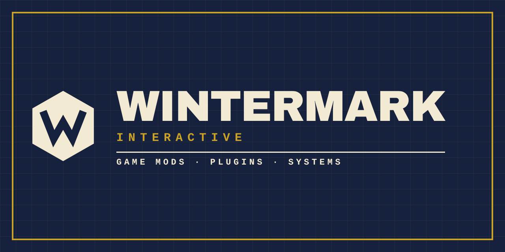

  

# Wintermark Interactive

**Game mods · plugins · systems.** Solo studio building gameplay systems for Software Inc., Minecraft and Roblox.

---

## Released: Software Inc. mods (Steam Workshop, free)

Showcase video: **[3 mods for Software Inc. on YouTube](https://youtu.be/lOPX3UajvCs)**

### AI Industry `v1.1` · 3 parts
Build an AI lab: a new AI Platform software type, AI rival companies and a compute cluster for training.

- 3 categories (Enterprise API 1986, Chat Assistant 2010, Code Model 2016), 5 feature groups, 50 features
- 3 rival company types: AI Labs, Enterprise AI, AI Coding Tools
- AI Compute Cluster furniture: 250,000 Mbps, 25% faster training
- The code mod adds the AI lab gameplay on top of the data and furniture parts

| Part | Type | Link |
|---|---|---|
| AI Lab | Code mod | [Workshop](https://steamcommunity.com/sharedfiles/filedetails/?id=3843314038) |
| AI Software & Companies | Data mod | [Workshop](https://steamcommunity.com/sharedfiles/filedetails/?id=3843313443) |
| AI Compute Cluster | Furniture | [Workshop](https://steamcommunity.com/sharedfiles/filedetails/?id=3843314340) |

### Internet Provider `v1.1` · 2 parts
Run your own ISP: buy network hardware, sell internet subscriptions and grow a subscriber base.

| Part | Type | Link |
|---|---|---|
| ISP | Code mod | [Workshop](https://steamcommunity.com/sharedfiles/filedetails/?id=3843313909) |
| Network Hardware | Furniture | [Workshop](https://steamcommunity.com/sharedfiles/filedetails/?id=3843314477) |

### Outsource Inc. `v1.0` · 1 part
Hire outside companies for any job (development, updates, ports, beta), with a fee and a small speed cost.

- 5–15% slower than your own team, +30–80% fee
- Fees show up under Marketing/Contracts

[Workshop](https://steamcommunity.com/sharedfiles/filedetails/?id=3843314181)

**Tech:** C# 6 code mods compiled against the game's own runtime, XML/TyD data mods, custom furniture with isometric 3D models, and an offline test harness to compile and check mods before they reach the game.

---

## Coming next

- **Minecraft:** Paper/Spigot plugins and ready-made server setups (Modrinth, CurseForge, BuiltByBit)
- **Roblox:** *AI Data Center Tycoon* and reusable Roblox systems

## Commissions

Custom mods, Minecraft plugins, server setups and Roblox systems.
Contact: **wintermarkinteractive@gmail.com**
